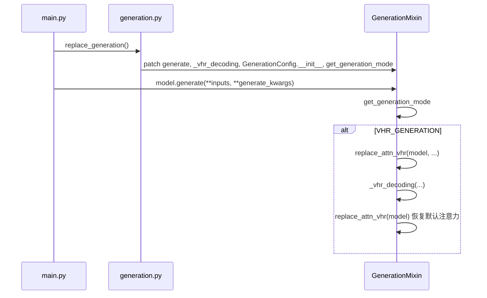

# 第 3–4 周：解码策略与 `generate` 集成（本仓库）

## 学习目标

- 理解 **greedy / beam / sampling** 与 `GenerationConfig` 各字段如何决定走哪条分支。
- 理清 **启动顺序**：`main.py` 里 `replace_generation()` → 用户调用 `model.generate(...)` → `get_generation_mode` → `VHR_GENERATION` → `replace_attn_vhr` + `_vhr_decoding`。
- 能说明 **text-contrast（无图/截断）** 的 `input_ids` 与 `model_kwargs` 在 [`_vhr_decoding`](../../generation.py) 里如何构造。

---

## 1. 解码策略速查

| 模式 | 典型配置 | 下一 token 怎么选 |
|------|-----------|-------------------|
| Greedy | `do_sample=False`, `num_beams=1` | `argmax` |
| Beam | `num_beams>1`, `do_sample=False` | 维护多条部分假设，按得分扩展 |
| Sample | `do_sample=True` | 按温度等调整后的分布 **采样** |

本仓库 [`main.py`](../../main.py) L78-L82：`beam` 在 method 名字里则 `num_beams=5`；`sample` 在 method 里则 `do_sample=True`。

**重要限制**（读 [`get_generation_mode`](../../generation.py) L1897-L1935）：

- **VHR**：`vhr_layers is not None` 时，仅当基础模式为 `greedy_search` 或 `sample` 才变为 `VHR_GENERATION`；**beam 与 VHR 不共用**（会 `ValueError`）。
- **DoLa**：类似，仅 greedy/sample。
- **OPERA**：要求 **beam_search**（`num_beams` 等配置配合）。
- **VCD / CODE**：在 greedy/sample 上扩展。

---

## 2. 启动链：从入口到补丁

阅读锚点：

1. [`main.py`](../../main.py) L12-L18：import 与 `replace_generation()` 在 import 后立刻执行。
2. [`generation.py`](../../generation.py) L1940-L1947：`replace_generation` 挂接的符号列表。
3. [`generation.py`](../../generation.py) L1380-L1398：`VHR_GENERATION` 分支里先 **注入** `vhr_forward`，再跑 `_vhr_decoding`，最后 **无参** `replace_attn_vhr(self)` 恢复层上的 forward。

---

## 3. `GenerationConfig` 与本仓库扩展字段

[`generation_config_init`](../../generation.py) 在标准字段之后增加（节选）：

- **VHR**：`vhr_layers`, `vhr_aug_ratio`, `vhr_filter`, `vhr_image_start`, `vhr_image_end`
- **A-VHR**：`vhr_use_avhr`, `vhr_tau`, `vhr_alpha`, `vhr_rho_max`
- **VCD**：`images_cd`, `cd_alpha`, `cd_beta`
- **OPERA / CODE**：见同函数后半

这些字段由 **`generate(..., **kwargs)`** 传入时合并进 config；与 [`main.py`](../../main.py) `generate_kwargs.update({...})` 对齐。

---

## 4. `_vhr_decoding`：循环结构与「第一次 forward」

文件：[`generation.py`](../../generation.py) `_vhr_decoding`（约 L25 起）。

**外层**：标准自回归 `while _has_unfinished_sequences`；每步 `prepare_inputs_for_generation` → `self(**model_inputs)` → `argmax`/`multinomial` → 拼接 `input_ids`。

**关键：仅首轮构造 text-contrast**（`model_kwargs_tc is None` 时）：

- 复制 `input_ids` → `input_ids_tc`，深拷贝 `model_kwargs` → `model_kwargs_tc`。
- **LLaVA 类**（`image_start > 0`）：去掉图像 token 段，使对比路径 **无图**；同步裁切 `attention_mask`。
- **InstructBLIP**（`image_start == 0` 分支）：从 `inputs_embeds` 前面裁掉固定长度（实现里为 32），模拟 **无视觉前缀** 的对比输入。
- 对 `model_kwargs_tc` 重新 `_get_initial_cache_position`，再 `prepare_inputs_for_generation`。
- 执行 **`outputs_tc = self(**model_inputs_tc)`**：这一次 forward 会驱动各层注意力的 **第一次 prefill**（在 `vhr_forward` 里缓存 `attn_output_tc`），但**不消费**其 logits 选 token；真正选 token 用的是紧接着对 **完整多模态输入** 的 `outputs`。

随后每步生成仍用完整 `model_inputs` 做 forward，进入 `vhr_forward` 的第二次 prefill 或 decode 分支（详见 [03-lvlm-vhr-avhr.md](03-lvlm-vhr-avhr.md)）。

---

## 5. `utils.py`：模型分支与层访问

| 函数 | 作用 |
|------|------|
| [`get_model`](../../utils.py) | 按路径选 InstructBLIP / LLaVA-NeXT / LLaVA-1.5；设 `attn_implementation`（`main` 里 eah → eager，否则 sdpa；InstructBlIP 强制 eager） |
| [`get_layers`](../../utils.py) | 统一 `model.language_model.model.layers` 或 `model.model.layers`，供数层数、配 `vhr_layers` |
| [`replace_instructblip_forward`](../../utils.py) | 支持无图 forward，服务对比路径 |

---

## 6. `main.py` 中与各 method 相关的 `generate_kwargs`

精读 [`HallucinationTest.infer_dataset`](../../main.py) L84-L193：

- **vhr / avhr**：`vhr_layers` 由「最后 N 层」+ 可选 `layer1` 组成；传 `vhr_image_start` / `vhr_image_end`；`avhr` 子串打开 A-VHR 超参。
- **dola**：改写 `num_hidden_layers` 与 `dola_layers` 列表。
- **vcd**：扩散噪声图、`images_cd`；InstructBlIP 分支把噪声经 Q-Former 变成 `language_projection` 张量。
- **opera**：`output_attentions=True` + 位置字典。
- **code**：先描述再生成，把描述 token 替代图像区。
- **eah**：`replace_attention_with_eah(self.model, ...)`（[`main.py`](../../main.py)）。

---

## 7. 实践作业

1. 在 IDE 中对 [`generation.py`](../../generation.py) 搜索 `GenerationMode.`，列出所有自定义模式名与对应 `_xxx` 函数。
2. 对照 [`get_image_position`](../../main.py) L208-L225，说明 LLaVA 与 InstructBLIP 在 `img_start` / `img_token_end` 上的差异。

---

## 8. 本周自检清单

- [ ] 能口头说明为什么 VHR 路径里要先 `replace_attn_vhr` 再解码、结束后再调用一次恢复。
- [ ] 能指出 `vhr_image_start` / `vhr_image_end` 在 `_vhr_decoding` 里如何参与裁切对比输入。
- [ ] 理解 `get_generation_mode` 中多个扩展（DoLa/VHR/VCD/…）的判断顺序是否会叠加冲突（读错误信息）。

下一周：[03-lvlm-vhr-avhr.md](03-lvlm-vhr-avhr.md)。
