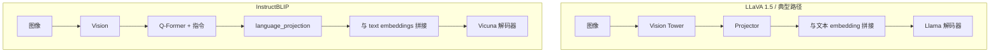

# 第 5–6 周：视觉语言模型（LVLM）与 VHR / A-VHR

## 学习目标

- 能说清 **图像 → 视觉编码 →（投影 / Q-Former）→ 与文本 token 拼接 → 解码器** 在本仓库三条模型路线上的差异。
- 能把 **两遍 prefill + 解码步复用加权** 与 [`vhr.py::vhr_forward`](../../vhr.py) 的三段分支一一对应。
- 读懂 **A-VHR** 与 [`experiment/A-VHR.md`](../../experiment/A-VHR.md) 中公式在代码里的变量名。

---

## 1. 本仓库的三类 LVLM（简图）



实现入口：[`utils.py::get_model`](../../utils.py)。

| 路线 | 模板 / 特殊点 |
|------|----------------|
| LLaVA 1.5 | `USER: <image>\\n{question} ASSISTANT:`；`num_img_tokens=576`；`image_token_id` |
| LLaVA-NeXT | `apply_chat_template`；`num_img_tokens` 运行时由 `image_token_id` 计数 |
| InstructBLIP | `template = "{question}"`；无 `image_token_id`；forward patch 支持无 `pixel_values` |

---

## 2. 幻觉评测（结合 `eval/`）

- **POPE**：是/否「图中是否有某物体」类问题，看准确率等（见 [`eval/eval.py`](../../eval/eval.py) `eval_pope`）。
- **CHAIR**：生成 caption 与 COCO 物体统计的一致性；[`eval/eval.py`](../../eval/eval.py) `eval_chair` 调 COCOEvalCap + [`chair.py`](../../eval/chair.py)。
- **LLaVA-Bench In-the-Wild**：[`eval/llava_wild.py`](../../eval/llava_wild.py) 用 OpenAI API 对两个回答打分（准确性、细节、自然度等）。

数据集加载：[`main.py::load_dataset`](../../main.py) → [`datasets.py`](../../datasets.py)（本讲义不展开每类字段，读脚本内 `__getitem__` 即可）。

---

## 3. VHR 核心：`vhr_forward` 三段逻辑

文件：[`vhr.py`](../../vhr.py)。

张量约定：`attn_output` 形状为 `(bsz, num_heads, q_len, head_dim)`（SDPA 输出）。

### 3.1 第一次 prefill（text-contrast 路径）

条件（L115-L117）：`attn_output.shape[-2] > 1` 且尚未有 `attn_output_tc`。

行为：把当前步 **最后一个 query 位置** 上、**所有 head** 的向量 `now_attn_output` 存到 `self.attn_output_tc`。

含义：这条 forward 对应 **去掉视觉信息** 的对比输入（由 `_vhr_decoding` 构造），得到「纯文本条件下」的注意力输出切片。

### 3.2 第二次 prefill（完整多模态）

条件（L119）：同样 `q_len>1`，但 `attn_output_tc` 已存在。

- 计算 `head_vary = ((attn_output_tc - now_attn_output)**2).sum(-1)`（L121），按 head 聚合差异。
- 可选 `filter`（L122-L124）：抑制高方差且能量也高的离群 head。
- **原版 VHR**（L136-L139）：`head_vary > median` 的 head 记为 `aug_heads`，乘以 `aug_ratio`。
- **A-VHR**（L127-L135）：`mu`、`s` 为层内均值与标准差；`sigmoid((head_vary-mu)/(tau*s))` 得连续门控；`ratio = 1 + (rho_max-1)*gamma_l*gate`；**逐 head 乘**在 `attn_output` 上；保存 `aug_ratio_per_head` 供 decode 复用。

然后清空 `attn_output_tc`（L125），结束「标定」阶段。

### 3.3 解码步（`q_len == 1`）

条件（L141-L146）：不再重算 `head_vary`，直接套用 prefill 得到的 `aug_ratio_per_head` 或 `aug_heads`。

---

## 4. A-VHR 与层深衰减

- 公式与符号：完整写在 [`experiment/A-VHR.md`](../../experiment/A-VHR.md) §1.2。
- **代码**：[`vhr.py::_compute_gamma_l`](../../vhr.py) 与 [`replace_attn`](../../vhr.py) 里对 `target_layers` 内每层传入 `avhr_gamma_l`。
- **CLI**：[`main.py`](../../main.py) `--vhr_tau`, `--vhr_alpha`, `--vhr_rho_max`；`method` 含 `avhr` 时 `vhr_use_avhr=True`（经 `generate_kwargs` 进入 `GenerationConfig`）。

---

## 5. 时序图（与 `generation.py` 配合）

```mermaid
sequenceDiagram
  participant Loop as _vhr_decoding_loop
  participant M as model_forward
  participant Attn as vhr_forward
  Loop->>M: forward text-contrast batch
  M->>Attn: prefill q_len>1, pass1
  Attn->>Attn: save attn_output_tc
  Loop->>M: forward full multimodal batch
  M->>Attn: prefill q_len>1, pass2
  Attn->>Attn: head_vary, set aug_heads or aug_ratio_per_head
  loop each_decode_step
    Loop->>M: forward one new token
    M->>Attn: q_len==1
    Attn->>Attn: apply stored scaling
  end
```

---

## 6. 并列方法：EAH

[`eah.py`](../../eah.py) 在 **不同层** 上替换注意力行为，且 `main` 使用 `attn_implementation="eager"` 以支持需显式 attention 权重的实现。与 VHR **不是同一条算法线**，并置学习有助于理解「解码期改注意力」的多种思路。

---

## 7. 实践作业

1. 手画一张表：列「prefill 第 1 次 / 第 2 次 / decode」×「`q_len`」「`attn_output_tc` 是否非空」「是否改 `attn_output`」。
2. 将 [`experiment/A-VHR.md`](../../experiment/A-VHR.md) 的 \(\tau,\alpha,\rho_{\max}\) 与 [`main.py`](../../main.py) 参数、`generation_config_init` 字段对应列出来。

---

## 8. 本周自检清单

- [ ] 能解释为何用「最后一个 token」的注意力输出表征来对比（与生成时关心「接在 prompt 后」的语义一致）。
- [ ] 能区分 `aug_heads`（离散头集合）与 `aug_ratio_per_head`（A-VHR 连续倍率）。
- [ ] 能说明 InstructBLIP 无 `image_token_id` 时 `_vhr_decoding` 如何用 `inputs_embeds[:, 32:]` 做对比。

下一周：[04-paper-repro-eval.md](04-paper-repro-eval.md)。
